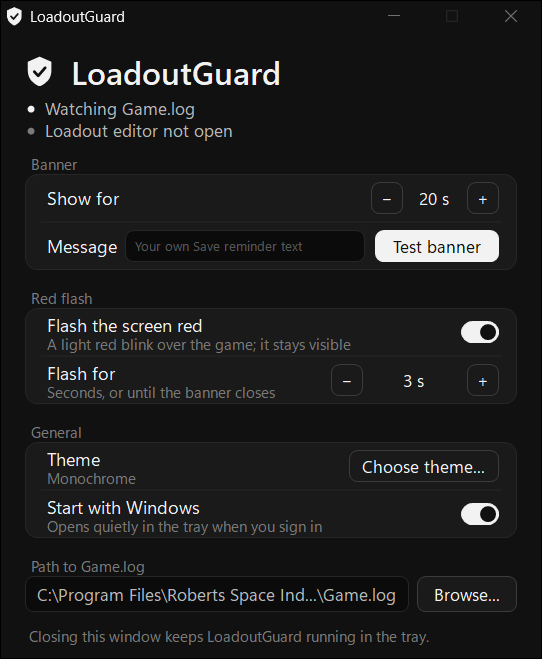

# LoadoutGuard

A tiny Windows tray app that reminds you to **save your ship insurance** after you change a ship loadout in Star Citizen.

Since the new insurance system, saving a loadout no longer updates your insurance. You also have to save insurance at an MFD. If you forget, you lose your upgraded components when the ship is destroyed. LoadoutGuard reminds you the moment you click **SAVE CHANGES AND EQUIP**.

<p align="center"></p>

> Unofficial fan project. Not affiliated with or endorsed by Cloud Imperium Games. Star Citizen® is a trademark of Cloud Imperium Rights LLC.

## How it works

When you click **SAVE CHANGES AND EQUIP** in the Vehicle Loadout Manager, LoadoutGuard reminds you: "Loadout saved. Your insurance is NOT updated. Save insurance at the MFD now." Only your own clicks trigger it; other players can't.

The reminder is a small banner at the top of the screen the game is on, and the screen **blinks lightly red**, once a second, for 3 seconds by default. You can make it blink longer, or until the banner closes. The red stays see-through, so you always see the game, and clicks go straight through it. The banner does not take focus from the game. Click it to close it (this also stops the blinking), or it closes by itself after 20 seconds.

### How the Save click is detected

The game writes no log line when you save a loadout or save insurance (checked on build 12913470). So LoadoutGuard combines two things:

1. LoadoutGuard reads the game's own log file (`StarCitizen\LIVE\Game.log`) once per second, which shows when the loadout editor opens. For the next 15 minutes, LoadoutGuard watches left clicks. The rest of the time it doesn't watch the mouse at all.
2. A click counts as a save only if Star Citizen is the active window and the click lands on the **SAVE CHANGES AND EQUIP** button area, at the bottom right of the editor.

The button area is stored as a share of the game's menu area, so it fits **any resolution** (1080p, 1440p, 4K), with or without Windows display scaling. LoadoutGuard also **detects the aspect ratio** of the game window: Star Citizen draws its menus in a 16:9 area with black bars around it on **ultrawide (21:9, 32:9)** and **16:10** screens, and LoadoutGuard measures the click inside that area. Windowed mode works too: the window's title bar and borders are left out. Only the click position is used, not colours, so HDR doesn't matter.

### Safe to use with Easy Anti-Cheat

LoadoutGuard does **not**:

- read or write game memory
- inject anything into the game, or hook the game process
- send keyboard or mouse input, or block or change any click
- take screenshots
- connect to the internet

It reads a text file the game writes to disk, the same way community kill trackers do. While the loadout editor is open, it also uses a standard Windows low-level mouse hook to see where you click. That's the same mechanism Discord push-to-talk and AutoHotkey use, and it runs inside LoadoutGuard, not inside the game. No third-party tool is ever officially guaranteed safe by CIG, but this is a low-risk way for such a tool to work.

### Light on your PC

About 30 MB of RAM and effectively 0% CPU. Once a second it checks whether `Game.log` grew and reads only the new part. The mouse watcher only runs while the editor is open, and does a few arithmetic checks per click.

## Install

1. Download `LoadoutGuard.exe` from the [Releases](../../releases) page.
2. Run it. The LoadoutGuard window opens the first time; after that it starts quietly in the system tray (shield icon).
3. Play in **Borderless** window mode. In exclusive Fullscreen, Windows may hide the banner and the red blink.

No installer and no runtime to install. It uses .NET Framework 4.8, which is part of Windows 10 and 11.

Windows SmartScreen may warn you because the exe is not code-signed. Choose *More info* > *Run anyway*, or build it yourself (see below).

### If Smart App Control blocks the exe

**Smart App Control** (Windows 11) blocks unsigned apps and has no *Run anyway*. Install LoadoutGuard with PowerShell instead; it then runs without an exe file. Open PowerShell (Start menu > type `PowerShell`) and paste:

```powershell
irm https://raw.githubusercontent.com/Robtobbtull/LoadoutGuard/main/install.ps1 | iex
```

This downloads the source code of the latest release to `%LOCALAPPDATA%\LoadoutGuard`, adds **LoadoutGuard** to the Start menu and starts it. Each time LoadoutGuard starts, Windows PowerShell compiles that source in memory and runs it, so there is no exe for Smart App Control to block. Both scripts are short; read [install.ps1](install.ps1) and [LoadoutGuard.ps1](LoadoutGuard.ps1) first if you like. Starting takes a second or two longer than the exe, and it uses about 100 MB of RAM instead of 30 MB. Run the same command again to update.

To remove it, use **Uninstall** (see below).

### Uninstall

Right-click the tray icon and choose **Uninstall...**. This removes LoadoutGuard's settings, its startup entry, the PowerShell install and Start menu shortcut if you have them, and `LoadoutGuard.exe` itself, then exits.

**Start with Windows:** turn on **Start with Windows** in the window. LoadoutGuard then adds itself to your user's startup list (`HKCU\Software\Microsoft\Windows\CurrentVersion\Run`, value `LoadoutGuard`; no admin rights needed) and starts quietly in the tray when you sign in. **Uninstall** removes the entry too.

## The window

Open it by double-clicking the tray icon, or by starting `LoadoutGuard.exe` again. Every change applies at once; there's no Save button and no restart needed. On small or highly scaled screens (such as 1366x768, or a 1080p laptop at 150%) the window shrinks to fit.

- **Status**: whether `Game.log` was found, and whether the loadout editor is open and Save clicks are being watched.
- **Banner**: how long the banner stays, **Message** for your own reminder text (leave it empty for the standard message), and **Test banner** to check that the banner and the blink show over your game.
- **Red flash**: **Flash the screen red** turns the blink on or off. **Flash for** sets how long it blinks: 3 to 60 seconds, or **Until closed** to keep blinking until the banner closes.
- **General**: **Start with Windows** (off by default), and **Choose theme...**, which opens the theme picker: Monochrome (black and white, the default), Nebula (purple), Ember (clay), Midnight (blue), mobiGlas (cyan) or Paper (light). The theme also colours the banner, the tray icon and, on Windows 11, the title bar.
- **Path to Game.log**: where your log is. Use **Browse...** for another drive or the PTU.

Closing the window keeps LoadoutGuard running in the tray. Right-click the tray icon to **Pause reminders**, **Uninstall...** or **Exit**.

## Settings file

Everything is stored in `%APPDATA%\LoadoutGuard\settings.ini`. The window covers the everyday settings. The log pattern and the Save button area are only in the file; exit LoadoutGuard before editing it by hand.

| Setting | Default | What it does |
|---|---|---|
| `gameLog` | `C:\Program Files\Roberts Space Industries\StarCitizen\LIVE\Game.log` | Log to watch. If missing, LoadoutGuard looks for a LIVE install on all fixed drives. Point it at `PTU\Game.log` for the PTU. |
| `flash` | `true` | Blink the screen lightly red with each reminder. |
| `flashSeconds` | `3` | How long it blinks, in seconds (one blink a second). `0` blinks until the banner closes. |
| `theme` | `Monochrome` | `Monochrome`, `Nebula`, `Ember`, `Midnight`, `mobiGlas` or `Paper`. |
| `editorOpenPattern` | `<UI - LoadoutEditor> .*(InitLoadout\|OnLoadoutQueriesFinished)` | Regular expression for the "editor opened" log line, which starts watching for Save clicks. Empty turns Save detection off. |
| `saveButtonArea` | `0.754,0.799,0.904,0.856` | Where SAVE CHANGES AND EQUIP is: left,top,right,bottom as fractions of the game's 16:9 menu area (0 = left/top edge, 1 = right/bottom edge). On a 16:9 screen that is the whole game window. Use a dot as the decimal point. Empty turns Save detection off. |
| `bannerSeconds` | `20` | How long the banner stays on screen. |
| `customMessage` | empty | Your own text for the reminder banner, on one line. Empty shows the standard message. |

## Build from source

No install needed. Windows already includes the C# compiler.

```
build.cmd
```

This builds `bin\LoadoutGuard.exe`, then builds and runs the self-tests (`bin\SelfTest.exe`).

### Ultrawide or other aspect ratios

Ultrawide (21:9, 32:9) and 16:10 are detected by themselves (see *How the Save click is detected*). If a game patch moves the button, or reminders don't show on your screen, take a screenshot with the loadout editor open and find the button's pixel box. Leave out any black bars: measure from the edge of the picture inside them. Divide the x values by that picture's width and the y values by its height, and put those four numbers in `saveButtonArea`.

### When a game patch breaks detection

Replay a real log to see when LoadoutGuard saw the loadout editor open (and would have watched for Save clicks):

```
bin\SelfTest.exe "C:\Program Files\Roberts Space Industries\StarCitizen\LIVE\Game.log"
```

If nothing shows up after you used the loadout editor, search the log for `LoadoutEditor` and update the pattern in `src/Settings.cs` (and in your own `settings.ini`). Pull requests welcome.

Do not paste whole `Game.log` files into public issues. They contain your player name and ID, and other players' names too.

## Project layout

| File | Purpose |
|---|---|
| `src/LogTail.cs` | Reads new lines from `Game.log` without locking it; handles game restarts. |
| `src/Detector.cs` | Decides which clicks show a reminder, using the log line for the editor opening. |
| `src/ClickArea.cs` | The Save button area, as fractions of the game window. |
| `src/MouseWatcher.cs` | Sees clicks in the Star Citizen window while the editor is open. |
| `src/Settings.cs` | Reads and writes `settings.ini`. |
| `src/ReminderForm.cs` | The banner. |
| `src/ScreenFlash.cs` | The light red blink over the game. |
| `src/MainWindow.cs` | The settings window. |
| `src/Ui.cs` | Drawing helpers and the custom controls: switch, button, theme card. |
| `src/ThemePicker.cs` | The theme picker window. |
| `src/Theme.cs` | The colour themes. |
| `src/Program.cs` | Tray icon and main loop. |
| `install.ps1` | The PowerShell install, for PCs where Smart App Control blocks the exe. |
| `LoadoutGuard.ps1` | Starts LoadoutGuard from its source, compiled in memory by PowerShell. |
| `tests/SelfTest.cs` | Self-tests and the log replay tool. |

## License

[MIT](LICENSE)
